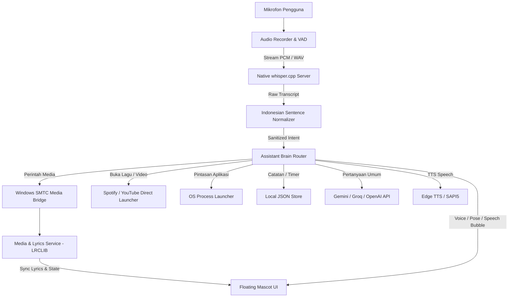

# Product Requirements Document (PRD)
## Dann Desktop Assistant — Smart Voice-Activated Desktop Companion

* **Nama Produk:** Dann Desktop Assistant
* **Versi:** 1.0.0
* **Default Wake Word:** `"Woii Dann"`
* **Platform Target:** Windows 10 / 11 (64-bit)
* **Arsitektur:** Electron 34 + React 19 + TypeScript + Vite + Native C++ whisper.cpp
* **Status Dokumen:** Aktif & Terverifikasi

---

## 1. Pendahuluan & Visi Produk

### 1.1 Latar Belakang
Sebagian besar asisten desktop virtual konvensional bersifat kaku, berbasis jendela utilitas standar yang membosankan, atau membutuhkan koneksi internet konstan untuk pengenalan suara dasar. **Dann Desktop Assistant** hadir sebagai asisten pribadi desktop cerdas dengan karakter maskot visual bernuansa **Neubrutalisme**, bekerja secara **100% offline secara lokal** untuk pengenalan suara dan kontrol media/aplikasi, serta didukung oleh kapabilitas hybrid cloud AI (Gemini / Groq / OpenAI) saat pengguna ingin mengobrol bebas.

### 1.2 Visi & Nilai Unik
1. **Visual Maskot Hidup & Ekspresif:** Karakter maskot berlabuh langsung di tepi bawah layar (*zero bottom gap*), dapat meluncur naik (*slide up*) dan turun (*slide down*) secara anggun, bereaksi terhadap musik yang sedang diputar (memakai headphone dan bergoyang), serta menampilkan lirik karaoke *real-time*.
2. **Pengenalan Suara Lokal & Cepat:** Didukung engine offline native C++ `whisper.cpp` (model GGML FP16) dengan *Voice Activity Detection (VAD)* cerdas yang tetap sensitif meski musik sedang diputar di latar belakang.
3. **Normalisasi Bahasa Indonesia Gaul & Percakapan (ASR Resilience):** Mentoleransi kesalahan fonetik ASR lisan khas Indonesia (misal: `"potifai"`, `"yutub"`, `"tar lagu"`, kata potong, koreksi diri di tengah kalimat, dan partikel santai seperti `"terus"`, `"coba"`, `"tolong"`).
4. **Kontrol Musik Terintegrasi Windows SMTC:** Mampu menjeda, melanjutkan, mengganti lagu (next/prev), membuka Spotify atau YouTube secara instan langsung ke video/lagu target, dan otomatis me-mute/pause lagu saat dipanggil agar percakapan terdengar jernih.
5. **Gaya Bahasa Ramah & Santai (Gaul yet Helpful):** Dann merespons dengan bahasa Indonesia yang natural, akrab, ringkas, dan tidak kaku.

---

## 2. Profil Pengguna (User Personas)

1. **Gamer / Multitasker:** Sering bermain game atau bekerja sambil mendengarkan musik di Spotify / YouTube. Membutuhkan kontrol lagu instan tanpa perlu memindah fokus jendela (*Alt + Tab*), cukup dengan suara atau klik kanan santai.
2. **Kreator Konten & Programmer:** Bekerja seharian di depan monitor dan menyukai teman interaktif di sudut layar yang tidak menghalangi area kerja, mampu memasang timer/pengingat, mencatat to-do list, dan memeriksa penggunaan RAM sistem.
3. **Pengguna Umum:** Menginginkan kemudahan membuka aplikasi, mencari video/referensi di YouTube & Google secara langsung tanpa repot mengetik.

---

## 3. Fitur Utama & Kebutuhan Fungsional (Core Requirements)

### 3.1 Voice Activation & Speech Pipeline
* **Wake Word Detection:**
  * Frasa pemicu utama: `"Woii Dann"` (dapat dikonfigurasi melalui Dashboard).
  * Mode opsional: **Always-Listen Mode** (selalu mendengarkan tanpa harus menyebut wake word terlebih dahulu).
* **VAD (Voice Activity Detection):**
  * Deteksi volume ambien adaptif dengan *start gate* capped pada `0.026` dan *ambient floor* `0.016`, mencegah mic terkunci saat speaker memainkan audio musik.
  * *Auto-pause on summon:* Saat kata pemicu terdeteksi, Dann otomatis menjeda audio yang sedang berputar di Windows (SMTC), menyapa pengguna (*"Iya! Musiknya aku pause dulu ya. Mau dibantu apa nih?"*), lalu mendengarkan instruksi dalam suasana hening.
* **Whisper Offline Native Engine:**
  * Menggunakan binary native `whisper-server.exe` (C++ GGML FP16 / Turbo / Small / Base) yang berjalan lokal tanpa koneksi internet dan tanpa mengirim rekaman audio keluar sistem.
  * Dukungan fallback ke pipeline `@huggingface/transformers` jika server lokal belum siap.

### 3.2 Dynamic Indonesian Speech Normalizer
* **Phonetic & Bigram Correction:** Mengoreksi kata-kata homofon atau salah tangkap Whisper (misal: `"sepotify"`, `"potifai"`, `"sportyfy"` $\rightarrow$ `Spotify`; `"taimer"`, `"temar"` $\rightarrow$ `Timer`).
* **Platform-First Syntax Recognition:** Memproses perintah dengan urutan kata santai seperti:
  * `"potifai putar lagu Hampa"` $\rightarrow$ Membuka dan memutar lagu *Hampa* di Spotify.
  * `"youtube putar lesti kejora"` $\rightarrow$ Membuka video *Lesti Kejora* di YouTube.
  * `"tar lagu febi putri"` $\rightarrow$ Otomatis melengkapi kata kerja *"tar"* menjadi *"Putar"*.
* **Conversational Filler Stripping:** Menghapus partikel pembuka seperti *"terus"*, *"lalu"*, *"dan"*, *"coba"*, *"tolong"*, *"bisa"*, *"eh"* sebelum mengevaluasi maksud perintah.
* **Spoken Self-Correction:** Menangani ralat lisan pengguna di tengah ucapan (contoh: *"Buka kalkulator, eh bukan, buka Spotify"* $\rightarrow$ mengeksekusi Spotify).

### 3.3 Neubrutalist Mascot UI & Floating Window
* **Zero Bottom Gap Torso Alignment:** Karakter diposisikan tepat di batas piksel terbawah desktop sehingga badan karakter menyatu alami dengan taskbar Windows.
* **Smooth Slide Up / Slide Down Animation:**
  * Karakter dapat meluncur turun bersembunyi di bawah layar saat diperintahkan (*"Pergi dulu"*, *"Minggir sana"*), atau setelah periode tidak ada aktivitas (*auto-hide*).
  * Karakter otomatis meluncur naik saat dipanggil (*"Woii Dann"*), saat ada reminder berbunyi, atau saat musik mulai dimainkan.
* **Peek Tab:** Ketika karakter sedang bersembunyi di bawah desktop, terdapat tab kecil neubrutalis di ujung bawah yang dapat diklik atau di-hover untuk memunculkannya kembali.
* **Mascot Quick Menu (Right-Click):**
  * Klik kanan pada karakter membuka panel kontrol cepat neubrutalis: geser posisi horizontal, kontrol pemutar musik (*Prev, Play/Pause, Next*), toggle Always-Listen, toggle lirik, dan tombol buka Dashboard.

### 3.4 Poses & Reaktivitas Karakter
* **Pose 1 (Idle / Standby):** Karakter santai tersenyum mengamati desktop pengguna.
* **Pose 2 (Listen / Grooving):** Karakter mengenakan headphone modern. Digunakan saat mendengarkan ucapan pengguna atau berjoget santai ketika musik/video sedang aktif diputar.
* **Pose 3 (Alert / Semangat):** Karakter ekspresif dengan gesture semangat saat pengguna meminta motivasi atau terjadi alarm pengingat.
* **Pose 4 (Idea / Solusi):** Karakter menunjuk lampu ide saat memberikan jawaban kalkulasi, catatan, atau saran perintah.

### 3.5 Music & Media Center (Windows SMTC & LRCLIB)
* **Deteksi Media Windows Global:** Membaca metadata lagu (Judul, Artis, App Source: Spotify, YouTube Music, YouTube Browser) via Windows System Media Transport Controls (SMTC).
* **Karaoke Synchronized Lyrics Bubble:** Mengambil lirik lrc tersinkronisasi milidetik dari LRCLIB API. Menampilkan baris lirik saat ini dan baris berikutnya secara *real-time* di atas kepala karakter.
* **Fallback Tampilan Musik:** Jika lagu tidak memiliki lirik LRC (seperti video klip biasa di YouTube), bubble tetap aktif menampilkan judul lagu dan artis dengan animasi *equalizer bars*.
* **Kontrol Suara Langsung Tanpa Wake Word:** Perintah kontrol media pendek seperti *"Pause"*, *"Jeda"*, *"Lanjut"*, *"Play"*, *"Next"*, *"Skip"*, *"Lagu sebelumnya"* dapat diucapkan langsung tanpa harus memanggil wake word terlebih dahulu.

### 3.6 Assistant Brain & Eksekusi Perintah
1. **Pintasan Aplikasi & Web:** Membuka aplikasi sistem (Kalkulator, Notepad, VS Code, Browser, File Explorer) dan shortcut kustom yang ditambahkan pengguna.
2. **Catatan Cepat & Daftar Tugas (Todo):** Menyimpan ide atau to-do list lewat suara (*"Catat beli kopi besok pagi"*).
3. **Timer & Alarm:** Menyetel pengingat dengan durasi fleksibel (*"Pasang timer 10 menit"*), disertai notifikasi audio dan visual bubble saat waktu habis.
4. **Kalkulator Matematika Kilat:** Menghitung operasi aritmatika lisan (*"Berapa 25 dikali 4?"*).
5. **Info Sistem & RAM:** Memberikan statistik pemakaian memori RAM laptop/PC secara lisan.
6. **Clipboard Assistant:** Menyalin teks yang diucapkan ke papan klip Windows.
7. **Hybrid Cloud AI Fallback:** Bila perintah adalah percakapan umum di luar pola lokal, Dann memanggil AI Cloud (Gemini 2.5 Flash / Groq Llama 3.3 / OpenAI GPT-4o-mini) dengan balasan JSON ringkas berbahasa Indonesia.

### 3.7 Interactive Dashboard Window
* **Overview Tab:** Kartu status sistem, status model offline Whisper, jumlah catatan/tugas, dan riwayat percakapan terkini.
* **Shortcuts Tab:** Manajemen daftar pintasan aplikasi dan link web favorit yang dapat dibuka lewat suara.
* **Notes & Tasks Tab:** Kanban / daftar catatan dan checklist to-do neubrutalis yang dapat dicentang, disematkan, atau dihapus.
* **Voice & Model Settings Tab:** Konfigurasi sensitivitas mic, wake word, toggle mode dengar terus, pengaturan auto-hide, serta pemilihan engine model Whisper (Base / Small / Turbo).
* **AI Provider Tab:** Pemilihan mode kecerdasan (Lokal Saja vs Gemini vs Groq vs OpenAI) beserta penyimpanan API key terenkripsi lokal.

---

## 4. Kebutuhan Non-Fungsional (Non-Functional Requirements)

| Kategori | Spesifikasi Target |
| :--- | :--- |
| **Latensi Respon Suara** | < 450 ms untuk perintah lokal (SMTC, waktu, kalkulator, pintasan). |
| **Sensitivitas Wake Word** | Akurasi pengenalan > 94% pada jarak bicara normal (30–90 cm dari mikrofon). |
| **Penggunaan Memori (RAM)** | < 180 MB saat *idle*, < 450 MB saat native whisper-server aktif. |
| **Beban CPU** | < 1.5% saat standby listening di background. |
| **Privasi Data** | Suara diolah sepenuhnya di mesin lokal pengguna; tidak ada data rekaman suara yang diunggah ke server mana pun. |
| **Kompatibilitas Layar** | Responsif terhadap berbagai resolusi (1366x768, 1920x1080 Full HD, hingga 4K) dengan penskalaan DPI Windows 100%–175%. |

---

## 5. Arsitektur Teknis & Aliran Data

---

## 6. Rencana Pengembangan Mendatang (Roadmap)

* [x] **v1.0.0 (Current):** Peluncuran stabil desktop assistant, Neubrutalist visual mascot, LRCLIB sync karaoke, native offline Whisper, SMTC voice controls, dan speech normalizer.
* [ ] **v1.1.0:** Fitur kustomisasi kostum & pakaian karakter maskot langsung dari Dashboard.
* [ ] **v1.2.0:** Integrasi kontrol smart-home lokal (Home Assistant API via HTTP/MQTT).
* [ ] **v1.3.0:** Mode percakapan suara interaktif bolak-balik tanpa henti (*Continuous Conversational Duplex*).

